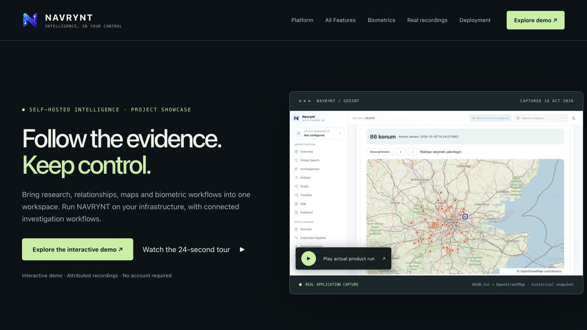
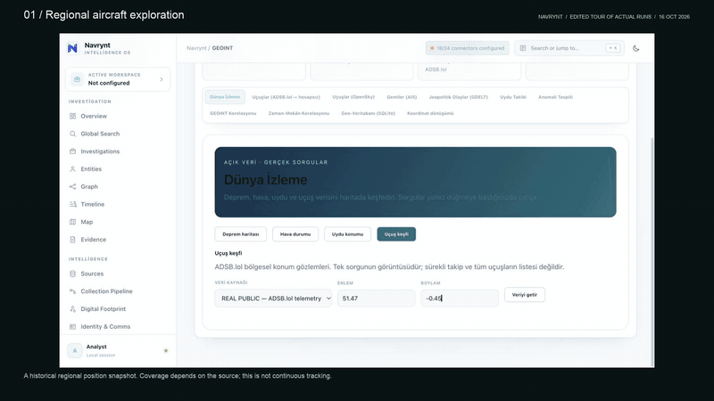
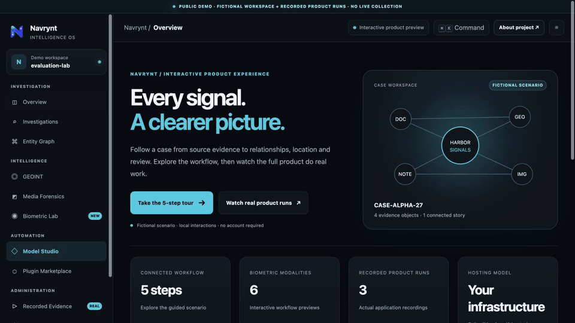
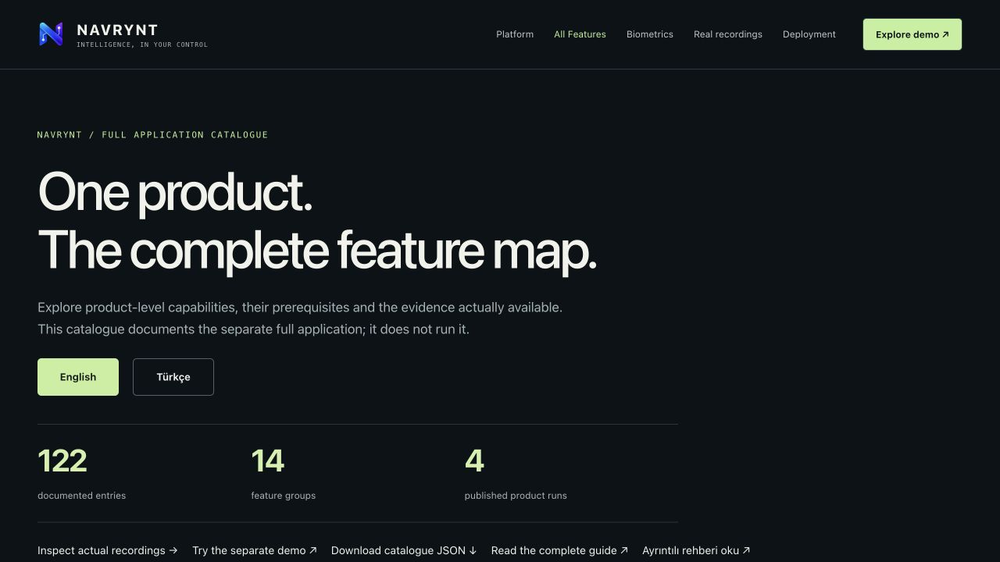
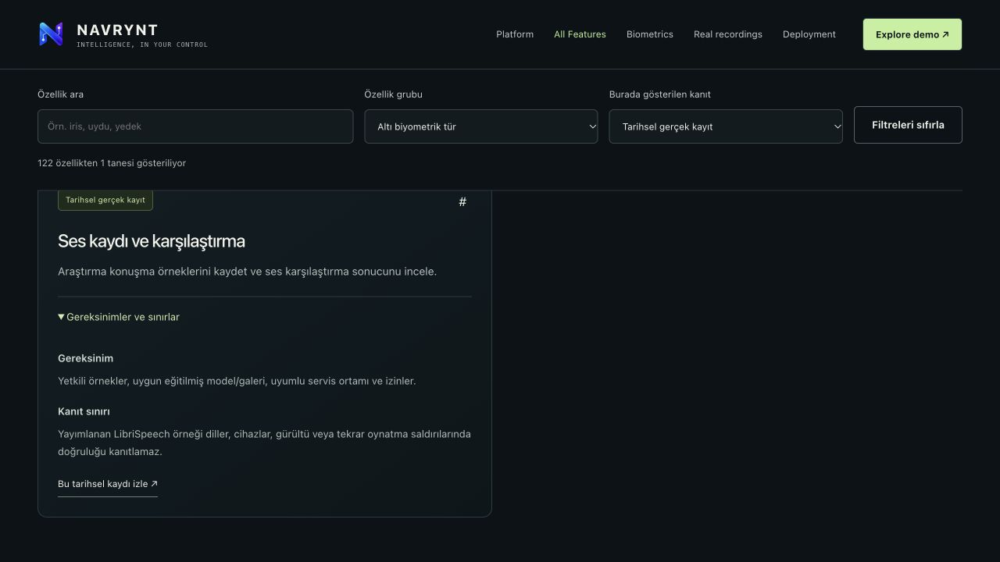
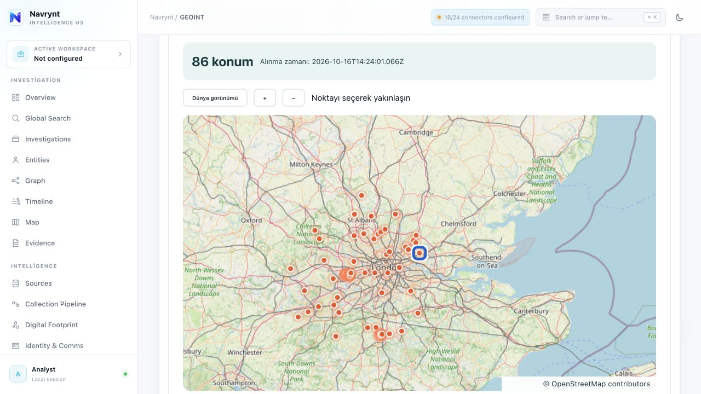
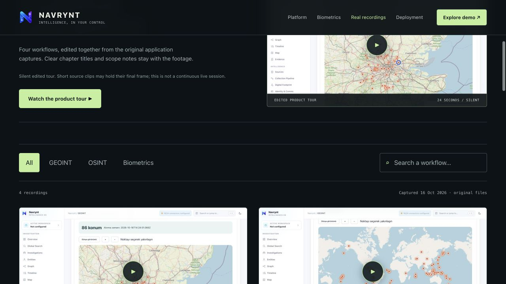
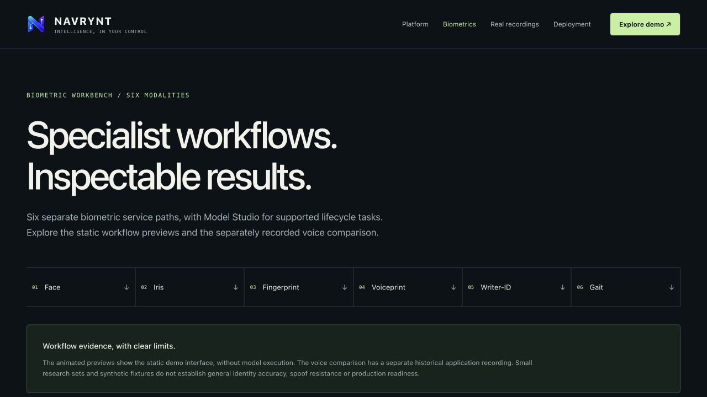
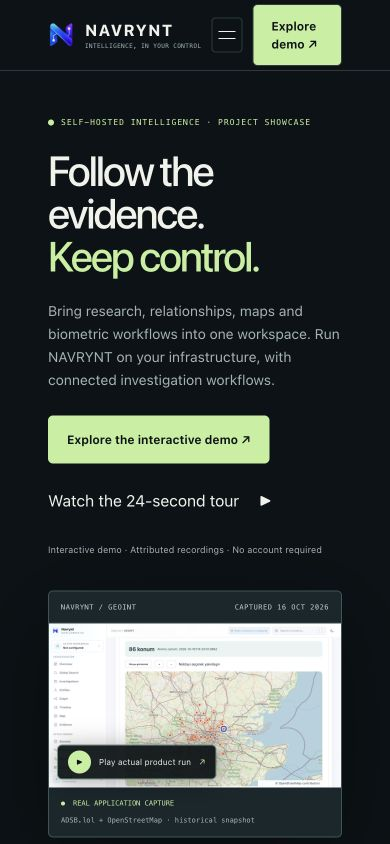

<p align="center"></p>
<h1 align="center">NAVRYNT · Project Website</h1>
<p align="center"><strong>Follow the evidence. Keep control.</strong></p>
<p align="center">A visual introduction to the NAVRYNT investigation workspace:<br>connected workflows, attributed product recordings and a clear path to the interactive demo.</p>

<p align="center">
  <a href="LICENSE"></a>
  
  
  
</p>
<p align="center">
  <a href="https://kaandevs-ops.github.io/navrynt-website-public/">Open website ↗</a> ·
  <a href="https://kaandevs-ops.github.io/navrynt-demo-public/">Try the demo ↗</a> ·
  <a href="README.tr.md">Türkçe</a> · <a href="https://kaandevs-ops.github.io/navrynt-website-public/features.html">All Features</a> · <a href="#recorded-product-workflows">Recordings</a> ·
  <a href="#quick-start">Quick start</a> ·
  <a href="#screenshots">Screenshots</a>
</p>



> **Presentation website.** This repository introduces the separate full application. It does not run an intelligence backend or biometric models. Product clips are historical recordings with source and research limits. The linked interactive demo uses fictional records and browser-local operations.

## Watch the product

[](site/assets/recordings/navrynt-real-product-tour.mp4)

**[▶ Watch the 24-second product tour](site/assets/recordings/navrynt-real-product-tour.mp4)** · [Open the recording library](https://kaandevs-ops.github.io/navrynt-website-public/recordings.html)

The silent tour edits four six-second chapters from actual application captures. Original clips are generally 3–4 fps; short clips hold their final frame. Titles and scope notes remain with the footage. This is not a continuous live session or interpolated motion. [Sources and media provenance](docs/MEDIA.md).

## What this website provides

| Area | Visitor experience |
|---|---|
| **Product overview** | See how research, relationships, maps and specialist workflows fit together |
| **Platform stories** | Review company relationships, earthquake events and regional aircraft observations |
| **Biometric documentation** | Explore six modality sections; distinguish static previews from the recorded voice example |
| **Recording library** | Filter by GEOINT, OSINT or Biometrics, search by text and inspect original screenshots |
| **Media viewer** | Play historical clips, read their scope, use descriptive captions and open the original files |
| **Deployment architecture** | Understand the separate frontend, backend, model services and external providers |
| **Capability scope** | Separate specific research evidence from configuration prerequisites and unverified combinations |
| **Responsive navigation** | Browse on desktop or mobile, with keyboard-accessible dialogs and menu controls |

## Website, demo and full application

| Component | Purpose | What executes |
|---|---|---|
| **This website** | Explain the project and present attributed evidence | Static navigation, search/filter controls and media playback |
| **Interactive demo** | Explore a connected fictional investigation | Case/graph/map interactions, actual local SHA-256 and non-executing example plans |
| **Separate full application** | Run configured investigation and specialist workflows | Backend, provider adapters and model services with required data and dependencies |

The public repositories do not contain the private application source, licensing tools, signing material, credentials, model weights or identity galleries. Provider accounts and deployment-specific validation remain separate requirements. No payment or ordering flow is included.

### Explore the interactive demo

[](https://kaandevs-ops.github.io/navrynt-demo-public/)

**[Open the demo](https://kaandevs-ops.github.io/navrynt-demo-public/)** · [Demo repository](https://github.com/kaandevs-ops/navrynt-demo-public) · [Full-product evidence inside the demo](https://kaandevs-ops.github.io/navrynt-demo-public/#proof)

The demo provides case review, selectable relationship nodes, generated tracks and real local hashing. Its six biometric tabs and Model Studio illustrate workflow stages without inference or training. The GIF shows captured browser states held for readability.

## Full-product feature catalogue

**[Browse all feature groups](https://kaandevs-ops.github.io/navrynt-website-public/features.html)** · **[Read the full guide](docs/FULL-PRODUCT.md)** · [Türkçe rehber](docs/FULL-PRODUCT.tr.md) · [Structured catalogue](site/features.json)

The source-reviewed catalogue contains **122 product-level entries in 14 groups**, covering the 25 main application navigation screens and additional API/CLI surfaces. It describes what each capability does, what it requires and the evidence attached to that specific operation. It is a documentation inventory, not a claim that 122 operations were executed or certified.

| Feature families | Examples |
|---|---|
| Investigation and evidence | Cases, history/snapshots, locks/presence, graphs, source context, integrity and exports |
| Collection and digital footprint | Source health, scheduled pipelines, normalization, web/domain discovery, usernames, phone metadata and breach integrations |
| Corporate and GEOINT | Company/ownership/vehicle/crypto sources, public events, aircraft/vessels, orbit propagation, coordinate transforms and correlation |
| Media and biometrics | Metadata, transcription/keyframes, location candidates, media indicators and six modality-specific service paths |
| Models and analysis | Lifecycle catalogues, model routing, datasets/benchmarks, retrieval, extraction, review and grounding |
| Automation and governance | Watchlists, alerts/reports, roles, retention, tenants, license verification, plugins and deployment prerequisites |

The catalogue distinguishes **four published historical runs**, **fictional demo illustrations** and **source-reviewed capabilities without a published run**. Requirements remain visible independently of evidence labels. A healthy service, registered adapter or feature count is not proof of model accuracy, provider availability or production readiness.

| Feature catalogue | Filtered historical evidence |
|---|---|
|  |  |

The page supports English/Turkish, text search, group/evidence filters and stable feature links. Both detailed guides and the page use the same curated catalogue. No private source files, credentials, keys, models or datasets are copied into the public guide.

## Recorded product workflows

Four original MP4/PNG pairs are included unchanged. All were captured on **16 October 2026**.

| Workflow | Source | Interpretation boundary |
|---|---|---|
| Regional aircraft exploration | ADSB.lol · OpenStreetMap | Historical position snapshot; coverage is source-dependent, not continuous tracking |
| Earthquakes in context | USGS · OpenStreetMap | Historical events; the captured view displays at most the first 150 positions |
| Company relationship review | GLEIF | Accounting consolidation relationship, not natural-person beneficial ownership |
| Voice enrollment and comparison | LibriSpeech · CC BY 4.0 | Research speech example, not a general accuracy or spoof-resistance benchmark |

| Aircraft observations | Company relationship |
|---|---|
| [](site/assets/recordings/aircraft.mp4) | [](site/assets/recordings/companies.mp4) |

Other biometric sections use labelled static-demo previews. A successful historical query or research job does not establish that every provider, model or production configuration works. [Complete attribution and limitations](docs/MEDIA.md).

## Screenshots

| Recording library | Biometric workflow documentation |
|---|---|
|  |  |

<details>
<summary><strong>Mobile homepage</strong></summary>



</details>

## Pages

| Page | Purpose |
|---|---|
| [Home](https://kaandevs-ops.github.io/navrynt-website-public/) | Product introduction, demo/product distinction and recorded workflow chapters |
| [All Features](https://kaandevs-ops.github.io/navrynt-website-public/features.html) | Searchable full-product catalogue with requirements and evidence labels |
| [Platform](https://kaandevs-ops.github.io/navrynt-website-public/platform.html) | Source context, geospatial observations and the fictional investigation flow |
| [Biometrics](https://kaandevs-ops.github.io/navrynt-website-public/biometrics.html) | Six specialist sections and their research boundaries |
| [Real recordings](https://kaandevs-ops.github.io/navrynt-website-public/recordings.html) | Four clips, sources, screenshots and edited tour |
| [Deployment](https://kaandevs-ops.github.io/navrynt-website-public/architecture.html) | Separate application components and integration prerequisites |
| [Capability scope](https://kaandevs-ops.github.io/navrynt-website-public/readiness.html) | Recorded evidence, reviewed coverage and deployment limitations |
| [Privacy](https://kaandevs-ops.github.io/navrynt-website-public/legal/privacy.html) | Browser, hosting and external-link boundaries |
| [Terms](https://kaandevs-ops.github.io/navrynt-website-public/legal/terms.html) | Project presentation terms |

## Quick start

No backend, API account, package installation or build is required. Python 3 serves static files:

```bash
git clone https://github.com/kaandevs-ops/navrynt-website-public.git
cd navrynt-website-public
python3 -m http.server 4174 --bind 127.0.0.1 --directory site
```

Open **[http://127.0.0.1:4174/](http://127.0.0.1:4174/)**. Port 4174 allows the demo to run separately on 4173. A current browser with JavaScript, CSS Grid and native MP4 playback is expected.

## Technology and structure

Plain **HTML, CSS and JavaScript**. Assets and videos are served directly; there is no application API, external font dependency or runtime package installation.

```text
site/                       Deployed static website
  index.html                Homepage and product overview
  features.html             Searchable bilingual feature catalogue
  features.json             Curated product-level capability inventory
  platform.html             Connected workflow stories
  biometrics.html           Six modality sections
  recordings.html           Searchable recording library
  architecture.html         Deployment explanation
  readiness.html            Evidence and capability boundaries
  legal/                    Privacy and terms
  website.css               Responsive interface
  website.js                Navigation, dialogs, chapters and filters
  recordings-data.js        Attributed runtime recording catalogue
  config.js                 Website and demo destination URLs
  assets/                   Branding, original recordings and labelled previews
docs/FULL-PRODUCT.md        Comprehensive English feature guide
docs/FULL-PRODUCT.tr.md     Comprehensive Turkish feature guide
docs/                       Source notes and deployment instructions
  media/                    Website screenshots and README GIFs
scripts/validate.py         File, link, syntax and original-media checks
.github/workflows/pages.yml Validation and Pages deployment
LICENSE                     Apache License 2.0
```

## Validation and publication

```bash
python3 scripts/validate.py
```

The standard-library validator checks local links, HTML IDs, image alt text, original and presentation media checksums, publication boundaries and JavaScript syntax when Node.js is available. Node is optional for local serving. The Pages workflow validates changes before deploying **only `site/`**; pull requests validate without deploying. [Hosting and configuration](docs/DEPLOYMENT.md).

Browser checks cover media playback, recording filters/search, modal controls and mobile navigation. They are not a comprehensive automated accessibility or production test suite for the separate full application.

## Feedback and license

[Report a reproducible issue](https://github.com/kaandevs-ops/navrynt-website-public/issues) with browser, viewport and steps. Keep credentials and personal data out of reports. [Contributing](CONTRIBUTING.md) · [Security](SECURITY.md).

Public code is licensed under **[Apache License 2.0](LICENSE)**. Captured third-party data retains its own source attribution and terms. Maintained by **[kaandevs-ops](https://github.com/kaandevs-ops)**.
